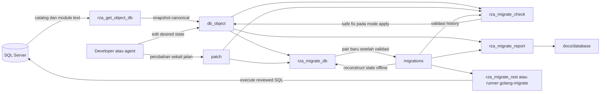

# Arsitektur dan Model Mental Engine Suite

Dokumen ini menjelaskan hubungan antar-engine. Mulai dari [Engine Docs Guide](../engine_docs_guide.md) untuk urutan baca, lalu gunakan [call tree](call_tree.md) untuk menelusuri fungsi dan [katalog paket](package_catalog.md) untuk menentukan lokasi perubahan.

## Tujuan dan batas sistem

Project ini mengubah definisi SQL Server yang dapat direview di repository menjadi pasangan migration. Lima aplikasi utama menangani pengambilan snapshot, pemeriksaan authoring, generation, pelaporan, dan execution. Dua utilitas tambahan dipakai untuk pengujian terhadap SQL Server nyata.

Target schema authoring adalah `dbo`. Dukungan T-SQL berupa subset yang eksplisit; keberadaan parser atau nama paket `tsqlast` tidak membuktikan dukungan seluruh grammar SQL Server. Status fitur mengikuti [capability matrix](../qa/sql_server_capability_matrix.md), bukan asumsi dari diagram ini.

## Konteks dan aliran data

Panah menunjukkan aliran input/output, bukan pemanggilan fungsi langsung. Checker apply juga dapat menormalkan encoding `patch`; checker `-check` tidak menulis authored SQL. Report hanya menghasilkan dokumentasi. Checker, generator, dan report bekerja offline; extractor dan executor mempunyai koneksi database.

## Tiga bentuk state yang harus dibedakan

| Bentuk | Pemilik dan makna | Implikasi saat pengembangan |
| --- | --- | --- |
| Desired state | `db_object/`: definisi akhir object yang dikelola | Edit di sini untuk mengusulkan perubahan schema. Menghapus file dapat berarti removal nyata. |
| Historical state | `migrations/`: history immutable, direkonstruksi secara offline | Jangan mengedit history untuk membuat diff hilang. `down` mengembalikan schema sejauh kontraknya memungkinkan. |
| Runtime state | SQL Server: object/data aktual, version/dirty, audit/journal | Tidak dibuktikan oleh offline verify atau report. Memerlukan pengujian/deployment terpisah. |

`patch/` menyimpan perubahan satu kali dengan `README.md`, `up.sql`, dan `down.sql`; setelah generation pertama source patch terikat integrity hash. Cache dan report pada `out/` adalah artefak turunan, bukan sumber desired/history ketiga. `out/object_management_manifest.json` mencatat pengecualian object yang tidak dapat diekspor dengan aman; maknanya dibatasi oleh [lifecycle](../desired_state_lifecycle.md).

## Tanggung jawab dan efek samping

| Komponen | Membaca | Menulis | Batas utama |
| --- | --- | --- | --- |
| Extractor | SQL Server metadata, config, initial migration exclusions | `db_object`, summary, management manifest | Bisa create/update/delete snapshot; tidak menghasilkan migration. `-dry-run` tetap membaca DB dan menulis summary CLI. |
| Checker apply | desired, patch, history | Safe correction source, diagnostic/cache di `out` | Tidak membuat atau mengubah migration. Default authoring memeriksa history pada level integrity. |
| Checker `-check` | Input yang sama | Diagnostic di `out`; authored SQL tetap | Pending correction menjadi blocking failure. Jangan menganggap read-only berarti tanpa file report. |
| Generator | Desired, patch, reconstructed history | Safe correction source, pair baru atau draft, diagnostic/cache | Tidak mengeksekusi SQL ke DB. `verify` sendiri tidak memperbaiki source. |
| Report | History dan current desired source | Bundle report/dokumentasi dengan manifest ownership | Tidak memodifikasi desired, patch, atau history; inferred relationship bukan constraint baru. |
| REST/runner | Reviewed migration + runtime config | SQL Server schema/data, version, audit/journal | Tidak melakukan desired-state diff atau generation. |
| Linux MR checker | Release + license + source digest + repository | `out/output.json` | Gate offline, flags authoring/integrity/read-only; gagal bila source/release tidak cocok. |

## Lapisan implementasi

1. `cmd/*` dan `internal/cmd`: parsing argumen, config, license, logging, lifecycle proses, exit code.
2. `internal/getobject`, `engine`, `migreport`, `migrest`: orchestration per domain. `engine` menghubungkan formatting, verify, reconstruction, planning, dan publication.
3. `sqlparse`, `sqlfmt`, `sqlfix`, `tsqlast`, `fsx`, `history`, `diff`, `emit`: helper bersama dengan scope yang berbeda. Semantic planning dan rendering migration masih banyak berada di `engine`; jangan mengasumsikan semuanya sudah pindah ke paket `diff`/`emit`.
4. `verify`, `output`, `management`, `config`: kontrol kontrak, diagnostic, metadata pengecualian, dan hard locks.
5. `handler`, `requestmeta`, `telemetry`: boundary HTTP dan observability untuk service.

## Keputusan desain yang perlu dipertahankan

| Keputusan | Alasan dan konsekuensi |
| --- | --- |
| Offline reconstruction dari history | Generation dapat direview tanpa akses production. Tidak membuktikan DB aktual sama dengan history. |
| Shared parser/fixer | Extractor, checker apply/plan, generator, dan Linux release memahami object dengan kontrak linear. Perubahan helper perlu ditelusuri ke semua consumer. |
| Ambiguitas menghentikan transformasi otomatis | Engine tidak menebak business logic atau equivalence yang belum terbukti. Report boleh mempertahankan uncertainty sebagai evidence. |
| Plan, round-trip, staging verify, lalu publish | Mencegah pair tidak valid menjadi hasil final. Publication tidak boleh overwrite history. |
| Up/down membawa definisi sebelumnya | Schema reversal dapat diaudit. Data yang dihapus tidak otomatis dapat dipulihkan; baca [guarded migrations](../engine_guarded_migrations.md). |
| Release lengkap dari satu source digest | Binaries yang dipakai MR harus membawa behavior yang diuji. Checksum sendiri tidak membuktikan binary dibuat dari source terkini. |

## Evidence dan keterbatasan

Call tree merupakan penelusuran statis terhadap source, bukan trace production. Uji Go/fixture membuktikan kontrak pada kasus yang dieksekusi; live SQL Server tests bersifat opt-in. Report membedakan FK declared, JOIN observed, module dependency, dan dynamic/ambiguous reference. JOIN tidak membuktikan uniqueness/cardinality, dan inferred impact tidak membuktikan semua runtime branch pernah dijalankan.

Untuk baseline source, hasil validasi, dan dokumen yang sengaja tidak diubah, lihat [review dokumentasi](../qa/documentation_review_20261022.md).
