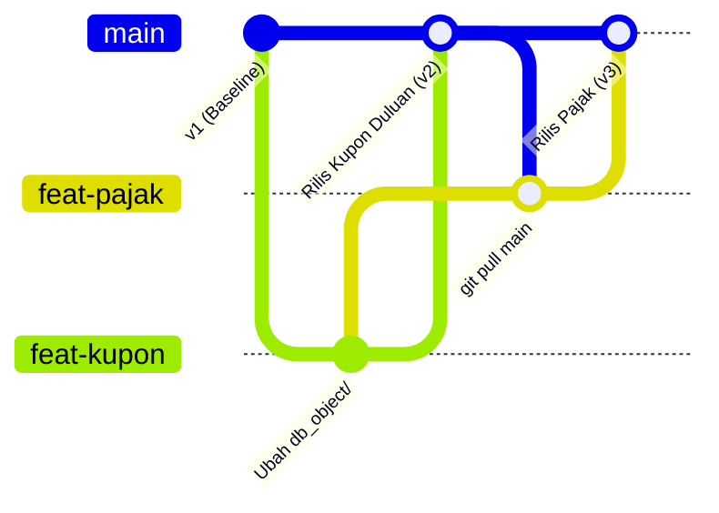

# Modern Database Migration & Deployment Architecture

Meninggalkan Tradisi Manual Menuju Alur Rilis Database Deklaratif, Aman dari Tabrakan Git, dan Ter-Audit Otomatis

  RZA Migration Suite · Enterprise Architecture Briefing

---

# Masalah #1: Tiga Bom Waktu Eksekusi Manual via SSMS

Kebiasaan membuka server database live dan melakukan copy-paste query adalah sumber utama insiden sistem.

  <h3 class="text-red-500 font-bold mb-2">Tragedi Patch Row 4.500</h3>
  

    Script patching update 10.000 data nasabah putus di tengah jalan karena timeout jaringan.
  

  

    Tanpa transaksi atomik (<code>BEGIN TRAN</code>), database berstatus <strong>setengah matang</strong>—separuh data berubah, separuh masih data lama.
  

  

    Dilema: Re-run takut duplikat, rollback tidak ada!
  

  

    
1. Backup SP ke Notepad Pribadi

    
Script lama di-copy ke laptop pribadi. Saat ada bug di Production, versi aslinya hilang atau tercecer.

  

  

    
2. Human Error Urutan DDL

    
Foreign Key dieksekusi sebelum tabelnya ada, atau script index terlewat tanpa disadari.

  

  

    
3. Salah Kamar Tab SSMS

    
Buka tab Dev dan Prod bersamaan. Niat tes di Dev, ternyata kursor aktif mengeksekusi di tab Production.

  

---

# Pertanyaan Besar: "Kenapa Nggak Pakai Golang-Migrate Biasa Aja?"

Bukankah lebih sederhana jika setiap developer cukup membuat file `.up.sql` langsung di folder `migrations/`?

  <h3 class="text-blue-400 font-bold mb-2">Ekspektasi Tim (Pola Sederhana)</h3>
  <ul class="text-sm space-y-2 opacity-80">
    <li>1. Developer membuat file di branch fiturnya: <code>20261101_add_col.up.sql</code></li>
    <li>2. Di-commit bersama kode program ke Git.</li>
    <li>3. Saat deploy, runner jalankan: <code>migrate up</code>.</li>
  </ul>
  

    Pola ini berhasil HANYA jika developernya cuma 1 orang dan jadwal deploy strictly satu per satu.
  

  <h3 class="text-red-400 font-bold mb-2">Kenyataan Fatal Multi-Branch</h3>
  <ul class="text-sm space-y-2 opacity-80">
    <li><strong>1. Jebakan Silent Skip:</strong> Jika branch lain rilis duluan, versi database target naik. File Anda yang bertanggal lebih lama DILEWATI tanpa pesan error!</li>
    <li><strong>2. Database Dirty State:</strong> Jika urutan dipaksa, database terkunci status DIRTY dan menolak migrasi berikutnya.</li>
    <li><strong>3. Kucing-kucingan Timestamp:</strong> Developer lelah me-rename tanggal file migrasi tiap kali ada fitur lain yang nyalip deploy.</li>
  </ul>

---

# Simulasi Kasus: Kronologi Kerusakan Akibat "Silent Skip"

Bagaimana fitur yang rilis duluan menggeser version schema dan memicu kegagalan sistem.

  
01. Kondisi Awal

  
1 November

  
DB di versi: <code>v20261001</code>

  
• Dev A (Pajak): <code>20261101_pajak.sql</code>

  
• Dev B (Kupon): <code>20261102_kupon.sql</code>

  
02. Kupon Nyalip

  
3 November

  
Fitur Kupon selesai testing duluan & dideploy ke Production.

  
Versi DB naik menjadi: <strong>v20261102</strong>.

  
Deploy Fitur B sukses.

  
03. Pajak Deploy

  
5 November

  
File Pajak bertanggal <code>20261101</code> (lebih tua dari versi DB <code>20261102</code>).

  
Aturan golang-migrate: Versi lama DILEWATI (Silent Skip)!

  
04. Incident Prod

  
Produksi Crash

  
Aplikasi live, tapi kolom <code>TaxAmount</code> TIDAK PERNAH DIBUAT di database.

  
Invalid column name TaxAmount

  
Nasabah gagal bayar.

---

# Masalah #2: Fitur Batal Rilis & Repo Buta (Tanpa Desired State)

  <h3 class="text-amber-400 font-bold mb-2">Dilema Fitur Batal Rilis di H-1</h3>
  

    Di plain golang-migrate, file migrasi sudah di-commit di branch rilis. Tiba-tiba bisnis menunda rilis fitur tersebut.
  

  <ul class="text-xs space-y-2 opacity-80">
    <li>• <strong>Jika file dihapus:</strong> Urutan timestamp versi jadi bolong/loncat.</li>
    <li>• <strong>Jika dibiarkan:</strong> Tabel terlanjur ter-alter padahal aplikasinya belum rilis.</li>
    <li>• <strong>Jika dibuatkan script revert:</strong> Histori migrasi jadi kotor berantakan.</li>
  </ul>

  <h3 class="text-blue-400 font-bold mb-2">Ketiadaan Desired State (Repo Buta)</h3>
  

    Di plain golang-migrate, tidak ada satu pun file di Git yang mencerminkan bentuk tabel saat ini.
  

  <ul class="text-xs space-y-2 opacity-80">
    <li>• Yang ada di repo cuma tumpukan 200 file migrasi lama bertimpaan: <code>add_col</code>, <code>drop_col</code>, <code>alter_col</code>.</li>
    <li>• Developer yang mau tahu struktur tabel hari ini terpaksa buka SSMS langsung ke live server atau menghitung 200 file di kepala.</li>
    <li>• Git kehilangan fungsinya sebagai <em>Single Source of Truth</em> bentuk skema database.</li>
  </ul>

---

# Solusi rza_migrate_db: Pemisahan Desired State vs History

Developer cukup mendeklarasikan bentuk akhir objek. Engine yang mengurus hitungan transisi perubahannya.

  Tugas Developer di Laptop
  <h3 class="text-lg font-bold mt-1 mb-3">Folder db_object/ (Desired State)</h3>
  <ul class="text-xs space-y-2.5 opacity-85">
    <li>• <strong>Deklaratif:</strong> Cukup nyatakan tabel dbo.Transaksi sekarang punya kolom TaxAmount.</li>
    <li>• <strong>1 Objek = 1 File:</strong> <code>db_object/tables/dbo.Transaksi.sql</code></li>
    <li>• <strong>Jelas di Merge Request:</strong> Reviewer melihat bentuk utuh tabel, bukan potongan ALTER acak.</li>
    <li>• <strong>Zero Migration:</strong> Dilarang membuat file di folder migrations/.</li>
  </ul>

  Tugas Engine Saat Rilis
  <h3 class="text-lg font-bold mt-1 mb-3">Folder migrations/ (History State)</h3>
  <ul class="text-xs space-y-2.5 opacity-85">
    <li>• <strong>Dihasilkan Otomatis oleh rza_migrate_db:</strong> Engine membandingkan desired state vs histori terakhir dan menghitung delta murni.</li>
    <li>• <strong>Timestamp Selalu Fresh:</strong> File migrasi baru dibuat saat mau rilis. Dijamin selalu lebih baru dari database target!</li>
    <li>• <strong>Selalu Berpasangan:</strong> Menyertakan .up.sql dan .down.sql rollback valid.</li>
    <li>• <strong>Transaksi Atomik:</strong> Dibungkus TRY/CATCH/THROW otomatis.</li>
  </ul>

---

# Mekanisme Git Branching: Solusi Mutlak Tabrakan Antar-Proyek

  

    
1. Proyek Lain Rilis Duluan?

    
Tim A cukup <code>git pull origin main</code>. Delta migrasi Tim A baru dihitung saat Tim A siap rilis. Tidak ada timestamp basi.

  

  

    
2. Fitur Batal Rilis di H-1?

    
Branch <code>feat/pajak</code> cukup JANGAN DI-MERGE ke main. Nol file migrasi yang perlu dihapus atau di-revert.

  

  

    
3. Resolusi Konflik Bersih

    
Konflik diselesaikan di file deklaratif menggunakan standard merge conflict tool Git biasa.

  

---

# Di Laptop Developer: Format & Validasi Mandiri (rza_migrate_check)

Developer memiliki linter otomatis di laptop: cukup double-click atau jalankan via terminal sebelum commit.

  
Langkah 01

  <h3 class="font-bold text-base mb-2">Edit di db_object/</h3>
  

    Ubah tabel atau SP langsung pada file SQL terkait di dalam <code>db_object/</code>.
  

  

    Dilarang membuat file di migrations/.
  

  
Langkah 02

  <h3 class="font-bold text-base mb-2">Jalankan Checker</h3>
  

    Double-click <code>rza_migrate_check.exe</code> atau via terminal:
  

  <ul class="text-xs opacity-80 mt-2 space-y-1">
    <li>• Normalisasi UTF-8 tanpa BOM</li>
    <li>• Rapikan line ending LF & spasi</li>
    <li>• Validasi penamaan constraint</li>
  </ul>

  
Langkah 03

  <h3 class="font-bold text-base mb-2">Commit & Buka MR</h3>
  

    Setelah status hijau (exit 0), commit dan push ke GitLab.
  

  

    Kode 100% rapi dan siap masuk CI.
  

---

# Di GitLab Pipeline: Satpam Otomatis Pemblokir Pelanggaran

  <h3 class="text-blue-400 font-bold mb-2">GitLab CI Stage: .pre</h3>
  <ul class="text-xs space-y-3 opacity-85">
    <li>• <strong>Mode Read-Only (-check):</strong> Menggunakan binary Linux resmi. Menolak memodifikasi file di repository runner.</li>
    <li>• <strong>Berjalan di Stage Terdepan:</strong> Gagal langsung menghentikan pipeline sebelum job build/test aplikasi yang mahal dijalankan.</li>
    <li>• <strong>Laporan di out/output.json:</strong> Kesalahan dicetak lengkap di console dan disimpan sebagai CI artifact.</li>
    <li>• <strong>Fail Hard (Exit 1):</strong> Tombol Merge terkunci otomatis hingga diperbaiki developer di branch fitur.</li>
  </ul>

  <h3 class="text-red-400 font-bold mb-2">Daftar Cekalan Satpam CI</h3>
  <ul class="text-xs space-y-3 opacity-85">
    <li>• <strong>Token Haram SQL:</strong> Menolak keras adanya perintah <code>GO</code>, <code>USE &lt;db&gt;</code>, <code>CREATE DATABASE</code>, atau <code>ALTER LOGIN</code>.</li>
    <li>• <strong>Encoding Ilegal:</strong> Menolak file UTF-16 atau UTF-8 dengan BOM yang menyebabkan runner Linux crash.</li>
    <li>• <strong>File Migrasi Ilegal:</strong> Menolak MR jika developer nekat menambahkan file <code>.up.sql</code> / <code>.down.sql</code> di branch fitur.</li>
    <li>• <strong>Sintaks Rusak:</strong> Memvalidasi integritas DDL dan nama constraint sebelum menyentuh main.</li>
  </ul>

---

# Di Meja Rilis: Draft, Review, dan Seal

Dilakukan setelah seluruh branch fitur di-merge ke branch main oleh Release Manager atau CI Release Step.

  
Fase 01

  <h3 class="font-bold text-base mb-2">rza_migrate_db draft</h3>
  

    Engine membandingkan seluruh histori migrations/ vs desired state terakhir db_object/.
  

  

    Menulis calon migrasi ke <code>out/draft_migrations/</code>. Folder resmi migrations/ belum tersentuh.
  

  
Fase 02

  <h3 class="font-bold text-base mb-2">Review DBA & Arsitek</h3>
  

    Arsitek atau DBA meninjau script calon migrasi sebelum disahkan:
  

  <ul class="text-xs opacity-80 mt-2 space-y-1">
    <li>• Cek lock tabel besar di jam sibuk</li>
    <li>• Cek kelayakan script rollback .down.sql</li>
    <li>• Cek precheck lossless konversi data</li>
  </ul>

  
Fase 03

  <h3 class="font-bold text-base mb-2">rza_migrate_db seal</h3>
  

    Memindahkan file yang sudah di-review ke folder resmi <code>migrations/</code>.
  

  

    Timestamp 17-digit deterministik diberikan. File siap di-commit dan dideploy ke target UAT/Prod.
  

---

# Operasional Server: Zero Direct SSMS Access

Tidak ada lagi user membuka SSMS ke server. Aplikasi berjalan di Pod OpenShift mengeksekusi migrasi secara terpusat.

  <h3 class="text-blue-400 font-bold mb-1">Opsi 1: REST API (Port 8080)</h3>
  
Otomasi Pipeline CD & HTTP Trigger

  
Header Wajib: X-API-Key, X-Request-ID, X-Operator-NIK

  <ul class="text-xs font-mono space-y-1.5 opacity-85">
    <li>GET  /api/v1/migrations/version</li>
    <li>GET  /api/v1/migrations/pending</li>
    <li>POST /api/v1/migrations/preflight</li>
    <li>POST /api/v1/migrations/up</li>
    <li>POST /api/v1/migrations/down</li>
    <li>POST /api/v1/migrations/recover-dirty</li>
  </ul>

  <h3 class="text-slate-200 font-bold mb-1">Opsi 2: In-Pod CLI (oc exec)</h3>
  
Eksekusi via Terminal Pod OpenShift

  <ul class="text-xs font-mono space-y-2 opacity-85">
    <li>app migrate version</li>
    <li>app migrate pending</li>
    <li>app migrate preflight --all</li>
    <li>app migrate up --all --request-id REQ-01 --nik 12345</li>
    <li>app migrate rollback --target-request-id REQ-01 --nik 12345</li>
    <li>app migrate recover-dirty --reason "Restart"</li>
  </ul>
  

    Dilengkapi <code>app curl</code> untuk testing lokal tanpa butuh curl di container Alpine.
  

---

# Sistem Pelacakan Berlapis: Dual-Level Audit & Concurrency Lock

  
Level 1: Audit Aplikasi & Operator · dbo.mig_operation_journal

  

    Mencatat: <code>operation_id</code>, <code>request_id</code>, <code>nik</code> operator, <code>operation</code>, <code>status</code>, <code>before_version</code>, <code>after_version</code>, <code>applied_files</code> (JSON array).
  

  

    Menjawab pertanyaan audit: "Siapa NIK operator yang mengeksekusi pada jam 02:00 pagi dan apa nomor tiketnya?"
  

  
Benteng Concurrency Lock · sys.sp_getapplock

  

    Saat OpenShift menjalankan multi-pod bersamaan, engine mengambil session lock eksklusif di SQL Server. Pod kedua otomatis mengantre atau ditolak aman. Tidak akan pernah terjadi race condition atau deadlock migrasi.
  

  
Level 2: Audit Database & Statement DDL · dbo.mig_event (via dbo.usp_mig_log_event)

  

    Mencatat detail per baris: <code>file_name</code>, <code>step_name</code>, <code>decision</code>, <code>action</code>, <code>run_key</code> (GUID unik batch).
  

  

    Di dalam blok CATCH SQL Server: Merekam persis error_number, error_message, dan error_line saat terjadi kegagalan DDL.
  

---

# Resiliensi Sistem: Preflight, LIFO Rollback, dan Dirty Recovery

  
Pilar 01

  <h3 class="font-bold text-base mb-2">Preflight Dry-Run</h3>
  

    Simulasi pra-eksekusi tanpa efek samping. Memeriksa in-flight lock dan memvalidasi kecocokan file migrasi dengan target database sebelum DDL sungguhan dijalankan.
  

  
Pilar 02

  <h3 class="font-bold text-base mb-2">LIFO Rollback</h3>
  

    Membatalkan perubahan satu paket rilis secara terbalik (Last-In, First-Out) berdasarkan target Request ID. Stored Procedure dan struktur tabel lama kembali ke titik awal.
  

  
Pilar 03

  <h3 class="font-bold text-base mb-2">Dirty State Recovery</h3>
  

    Jika server mati di tengah DDL dan database terkunci status DIRTY: panggil <code>app migrate recover-dirty</code>. Sistem pulih mandiri tanpa perlu manipulasi manual tabel sistem.
  

---

# Dokumentasi Database Otomatis: Zero Database Access

Tool <code>rza_migrate_report</code> membaca Git dan migrations/ secara offline untuk menghasilkan dokumentasi lengkap tanpa perlu terhubung ke database produksi.

  
Output 01

  <h3 class="font-bold text-base mb-1">relational_erd.md</h3>
  
Diagram ERD Visual (Mermaid)

  

    Memetakan seluruh tabel, primary key, foreign key, dan observed JOIN langsung render visual di GitLab tanpa software gambar manual.
  

  
Output 02

  <h3 class="font-bold text-base mb-1">module_lineage.md</h3>
  
Silsilah Dependensi Modul

  

    Menampilkan SP, Function, dan View mana saja yang terdampak saat suatu tabel diubah. Memungkinkan <em>impact analysis</em> instan sebelum rilis.
  

  
Output 03

  <h3 class="font-bold text-base mb-1">7 File CSV Audit</h3>
  
RFC-4180 Format

  

    Ekspor riwayat perubahan tabel, indeks, SP, tipe data, dan migration summary yang siap diolah di Excel atau sistem audit kepatuhan.
  

---

# Perbandingan Tiga Generasi

| Kriteria Evaluasi | 1. Manual SSMS | 2. Plain Golang-Migrate | 3. RZA Engine Suite |
| :--- | :--- | :--- | :--- |
| **Jika Proyek Lain Rilis Duluan** | Saling timpa manual di database | Bentrok timestamp & Silent Skip | Otomatis delta fresh saat rilis (Zero Bentrok) |
| **Jika Fitur Batal di H-1** | Pusing rollback query di server | File migrasi nyangkut di rilis | Cukup jangan merge branch fitur ke main |
| **Single Source of Truth** | Nihil (harus koneksi ke DB live) | Nihil (harus baca 200 file migrasi) | Jelas di db_object/ (Desired State Utuh) |
| **Transaksi Atomik** | Sering lupa BEGIN TRAN (data korup) | Tergantung disiplin developer | 100% TRY/CATCH/THROW otomatis |
| **Audit Kepatuhan & Tracking** | Logbook manual / nihil | Hanya versi di schema_migrations | Dual-Level: NIK, Request ID & DDL Event |

  <strong class="text-blue-400">Prinsip Arsitektur Kunci:</strong> 
  Menggunakan rza_migrate_db bukan untuk menambah birokrasi coding, melainkan membebaskan tim dari perangkap timestamp basi dan risiko lembur darurat di tengah malam. Menjaga branch fitur bersih dari file migrasi adalah asuransi ketenangan seluruh tim saat deployment produksi.

